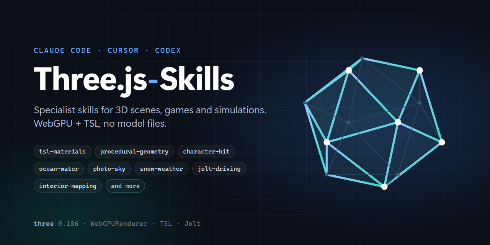

<div align="center">

# Three.js-Skills

**Specialist Three.js skills for Cursor, Claude Code, Codex and ChatGPT.**
**Geometry, shaders, materials, particles, fluids, and more.**

[](version.json)
[](LICENSE)
[](skills/)
[](https://threejs.org/)
[](https://threejs.org/docs/#api/en/renderers/webgpu/WebGPURenderer)
[](https://code.claude.com/docs)
[](https://cursor.com)
[](https://openai.com/codex)
[](https://chatgpt.com)

</div>

---

A catalog of agent skills for building 3D scenes, games and simulations: procedural
geometry and node materials, a controllable character, and outdoor kits for sky, weather,
ground cover, open water, terrain shading and vehicle physics. Target:
[Three.js](https://threejs.org/) 0.186.1, the WebGPU renderer (`three/webgpu`) and TSL
(`three/tsl`). WebGPU only: no WebGL
fallback, no GLSL strings. Everything is generated by code; no model files are loaded.
Physics, where used, is Jolt (`jolt-physics` WASM).

Each skill is a folder at `skills/<category>/<name>/` with a `SKILL.md` that says in its
first line when it applies; the model reads it before working in that area. Many skills
ship source files in a `scripts/` folder beside the instructions, and longer material in
`references/`; the tables below say which. The layout and the front matter follow the
[contributing rules](https://github.com/gamedev-skills/awesome-gamedev-agent-skills/blob/main/CONTRIBUTING.md)
of awesome-gamedev-agent-skills, so any skill here can be submitted there as it is.

## Quick Start

**Claude Code, as a plugin** (all 26 skills, invoked as `/threejs-skills:<name>`):

```
/plugin marketplace add wolffe/three.js-skills
/plugin install threejs-skills@threejs-skills
```

**Claude Code, copied into a project** (`~/.claude/skills/` for every project):

```bash
git clone https://github.com/wolffe/three.js-skills.git
cp -r three.js-skills/skills/*/* /path/to/project/.claude/skills/
```

**Cursor and Codex** read `.agents/skills/` in a project, or `~/.agents/skills/` for
every project:

```bash
git clone https://github.com/wolffe/three.js-skills.git
cp -r three.js-skills/skills/*/* /path/to/project/.agents/skills/
```

```powershell
git clone https://github.com/wolffe/three.js-skills.git
Copy-Item -Recurse -Force "three.js-skills\skills\*\*" ".agents\skills\"
```

**Try it inside this repo.** Clone, run `node scripts/sync-skills.mjs`, and open the
folder in any of the three tools; the mirrors it writes are what each tool reads.
Claude Code can also load it as a plugin for one session with `claude --plugin-dir ./`.

Copy only the skills a project needs; each folder stands alone, and a parent skill says
which children it expects.

## Examples

Projects built with these skills, in the browser, on Three.js and WebGPU:

| Project | What it is | Skills on show |
| --- | --- | --- |
| [Hard Road](https://hardroad.xyz/) | a free post-apocalyptic driving simulator: 226 km of tarmac, gravel and dirt across a cold, deserted Alaskan island, with rain, snow, a day-night cycle and a trailer to hitch | `jolt-driving`, `photo-sky`, `snow-weather`, `card-grass`, `far-shade`, `ocean-water`, `procedural-geometry` |
| [Vault 80](https://vault80.com/3d/) | a catalog of fifteen Three.js and WebGPU games, simulations and experiments in vanilla JavaScript with no build step: a quiet tide, billboard grass, a dead city, an O'Neill cylinder, a pixel material builder and more | `tsl-materials` and its children, `water`, `card-grass`, `megacity`, `engineered-environments`, `character-kit` |

## Skills (26)

### Orchestration

| Skill | Use for | Ships |
| --- | --- | --- |
| `threejs-director` | the entry point: reads a request that spans several areas, picks the skills, fixes their order and hands over; load first when it is not obvious which skill applies | |

### Materials

| Skill | Use for | Ships |
| --- | --- | --- |
| `tsl-materials` | the parent: how to think about and build any material as a TSL node graph; parents the six below | |
| `glass` | architectural, vehicle and train glass; portholes; generic building windows | |
| `metal` | painted, bare, brushed, galvanised, cast and weathered metal | |
| `paint` | painted surfaces as layers: primer, paint, clear coat, wear, dirt | |
| `rust` | oxidation and corrosion driven by masks with physical causes | |
| `water` | lakes, rivers, canals, puddles, fountains, wet surfaces: the principles (which water looks like what, foam placement, depth, scale variants); `ocean-water` below is the implementation | |
| `material-composition` | one object made of several physically distinct surfaces | |
| `interior-mapping` | rooms behind the windows of buildings that cannot be entered, on a flat pane | `scripts/windowMaterial.tsl.js` |

### Geometry

| Skill | Use for | Ships |
| --- | --- | --- |
| `procedural-geometry` | the vocabulary of built geometry: sweeps, lofts, revolves, panels, fillets; trains, tracks, stations, stairs, parapets, houses, containers, buildings, pipes, cables, bridges; quality, polygon budget, LOD | `references/modelling-vocabulary.md`, `references/objects.md` (read on demand) |
| `pipes` | pipework, ducts and conduits as an engineered service | `scripts/pipe-rack.js`, a parametric pipe-rack model, and `scripts/procedural-models.js`, the library it registers with |
| `signage` | signs, markings, labels and decals: when a texture, when geometry | |

### Environments

| Skill | Use for | Ships |
| --- | --- | --- |
| `station-maglev` | stations, platforms, guideways, switches, supports, circulation | |
| `megacity` | dense futuristic city architecture: massing, facades, podiums, districts | |
| `engineered-environments` | any large built place as a working system: ground and orientation, infrastructure hierarchy, human scale, repetition, storytelling | |

### Character

A kit for putting a controllable character into any 3D scene: walking, running,
crouching, jumping, first and third person cameras, keyboard and pointer input, and a
blocky procedural figure that animates from the controller's state.

The kit is genre-neutral. It knows nothing about any particular game: no engine object,
no scene registry, no asset pipeline. Each piece takes plain objects and functions and
returns plain objects and functions. Physics is Jolt 1.1.0 through one small adapter;
the rest of the kit talks to an interface of four calls, so another physics library can
be swapped in behind it.

| Skill | Use for | Ships |
| --- | --- | --- |
| `character-kit` | the parent: what a playable character is made of, the boot and frame order, the interfaces between the four pieces, and the measurements that make it feel right | |
| `character-walking` | locomotion on a physics capsule: walk, run, crouch, jump, slopes, stairs, moving platforms, ledge creep | `scripts/walking-controller.js` (Jolt CharacterVirtual adapter + the controller) |
| `character-camera` | first-person look and third-person orbit, drag or pointer-lock, scroll zoom, follow smoothing | `scripts/character-camera.js` |
| `character-model` | a 1.8 m blocky figure built from boxes with hip, knee and shoulder joints, a walk cycle, crouch and airborne poses, driven by speed and grounded state | `scripts/character-model.js` |
| `character-input` | keyboard actions with rebinding, edge-triggered presses, drag and pointer-lock look deltas, right-button turn, wheel steps | `scripts/character-input.js` |

### Sky and weather

| Skill | Use for | Ships |
| --- | --- | --- |
| `photo-sky` | a photographic sky: equirect photos on a dome, crossfaded by sun elevation with per-day, weather and night pools; the dome follows the clock's azimuth; exact ACES inverse so the photos blend in display space; PMREM bake gate | `scripts/photo-sky.tsl.js`, `scripts/convert-sky.html` + `scripts/convert-sky.mjs` (photo to slot conversion: crop, sun find, pre-rotate, measure elevation) |
| `snow-weather` | GPU compute snowfall and blizzards (64k flakes in a toroidal box around the camera, soft particles, exclusion boxes, camera bubble, ash variant), a weather spell scheduler (calm / steady / storm, cloud gate, rain or snow by a winter value, wetness integrator), ground powder, spray and how surfaces carry snow | `scripts/blizzard.tsl.js`, `scripts/weather-spells.js` |

### Ground cover

| Skill | Use for | Ships |
| --- | --- | --- |
| `card-grass` | truck-simulator style grass: one fixed-yaw textured card per clump from a 4x4 cutout atlas, jittered grid with a density field, hash yaw, flat-up lighting, root shadow, wind, distance sink, ground-hue tint, winter palette; per-tile instanced pooling | `scripts/card-grass.tsl.js`, `references/make-atlas.md` (ffmpeg + node recipe, brightness-normalised cards) |

### Water

| Skill | Use for | Ships |
| --- | --- | --- |
| `ocean-water` | a camera-following sea sheet: normalised Gerstner spectrum (ring or plane waves), top-level planar reflector with a layer whitelist, Fresnel, Beer-Lambert against a baked seabed tile, caustics, glint, foam, underwater path, scene fog; plus a generic planar mirror for lakes, ice and puddles | `scripts/ocean.tsl.js`, `scripts/planar-reflection.js` |

The principles (which water looks like what, foam placement, depth, scale variants) are
the `water` skill under Materials; this kit is the implementation.

### Terrain shading

| Skill | Use for | Ships |
| --- | --- | --- |
| `far-shade` | a fake ambient occlusion that replaces a far shadow cascade: a toroidal height + canopy atlas written per terrain tile, an 8-tap vertex-stage march toward the sun for hill and ridge shade, canopy blobs displaced down-sun, multiplied into albedo at every distance; no shadow pass | `scripts/far-shade.tsl.js` |

### Physics

| Skill | Use for | Ships |
| --- | --- | --- |
| `jolt-driving` | a drivable wheeled vehicle on Jolt: world setup and layers, body helpers, heightfield chunks on a 3x3 ring, a tuned VehicleConstraint (suspension, anti-roll, friction curves per surface, speed-sensitive steering, handbrake, water buoyancy, air gravity, flip/reset) and towing (swing-twist hitch, trailer springs, overrun brake, save/restore) | `scripts/jolt-world.js`, `scripts/jolt-vehicle.js`, `scripts/jolt-towing.js` |

## Usage Patterns

### Routed requests

`threejs-director` reads the request, picks the skills and fixes their order. Each arrow
is a skill handed the previous one's output.

```
# One material
"A brushed stainless handrail with fingerprints and a little rust at the welds"
→ threejs-director → tsl-materials → metal → rust

# One object
"A weathered delivery van: chipped white paint, rusty sills, tinted glass"
→ threejs-director → material-composition → paint → rust → metal → glass

# A place
"A maglev platform at dusk with lit windows on the concourse"
→ threejs-director → engineered-environments → station-maglev → procedural-geometry
  → metal + glass + paint → signage → interior-mapping → photo-sky

# A player
"Let me walk around the station in third person"
→ threejs-director → character-kit → character-input → character-walking
  → character-camera → character-model
```

### Direct requests

When the request names one area, load that skill directly and skip the director.
Children assume their parent: load `tsl-materials` with any material, `character-kit`
with any character piece, `water` with `ocean-water`.

```
"Make this lake reflect the sky"          → water → ocean-water (PlanarReflection)
"Add card grass to the verge"             → card-grass
"Put rooms behind these tower windows"    → interior-mapping
"Let it snow, then rain, then clear"      → photo-sky → snow-weather
```

## Workflow Pipelines

### Maglev station at dusk

```
engineered-environments → station-maglev → procedural-geometry
→ metal + glass + paint → signage → interior-mapping → photo-sky → character-kit
```

### Drivable winter road

```
photo-sky → far-shade → card-grass (winter palette) → procedural-geometry (road, barriers)
→ jolt-driving → snow-weather
```

### Coastal city

```
engineered-environments → megacity → procedural-geometry
→ tsl-materials + material-composition → interior-mapping → ocean-water → photo-sky
→ character-kit
```

### Industrial plant walkthrough

```
engineered-environments → procedural-geometry → pipes
→ metal + paint + rust → signage → character-kit
```

### One weathered vehicle

```
material-composition → paint → metal → rust → glass
```

The order is the same in every pipeline: place and scale, ground and sky, geometry,
materials, facades and cover, weather, then player and vehicles. Each stage leaves
something the next needs. `SKILLS_GUIDE.md` has the decision trees.

## Project Structure

```
skills/                      26 skills in 7 category folders; the source of truth
  ├── orchestration/         threejs-director, the router
  ├── materials/             tsl-materials and its seven children
  ├── geometry/              procedural-geometry, pipes, signage
  ├── environments/          engineered-environments, station-maglev, megacity
  ├── character/             character-kit and its four children
  ├── outdoor/               photo-sky, snow-weather, card-grass, ocean-water, far-shade
  └── physics/               jolt-driving
  (a skill folder holds SKILL.md, scripts/ for shipped source, references/ for long material)
.claude-plugin/              Claude Code plugin manifest and self-hosted marketplace
.claude/settings.json        hook: re-sync mirrors after every edit in Claude Code
.githooks/pre-commit         re-sync mirrors and validate before every commit
.github/workflows/           validate on push
scripts/
  ├── sync-skills.mjs        mirrors skills/ into .claude/skills and .agents/skills (ignored by git)
  └── validate-skills.mjs    layout, front matter, 500-line limit, links, README rows, director routes, manifests, versions
_assets/                     social preview image and its source
version.json                 the catalog version
```

The mirror folders `.claude/skills/` and `.agents/skills/` are generated and ignored by
git. They exist so the repo itself works as a project in Claude Code, Cursor and Codex.
Enable the pre-commit hook once with `git config core.hooksPath .githooks`.

## Documentation

| Doc | Purpose |
| --- | --- |
| [SKILLS_GUIDE.md](SKILLS_GUIDE.md) | the catalog tree, decision trees, which skills load together |
| [CONTRIBUTING.md](CONTRIBUTING.md) | how to add or change a skill |
| [CHANGELOG.md](CHANGELOG.md) | version history |
| `skills/orchestration/threejs-director/SKILL.md` | the routing table the model uses |

## Versioning

The catalog is versioned as a whole, following [Semantic Versioning](https://semver.org/).
The current version is in `version.json`, mirrored in `.claude-plugin/plugin.json` and
the badge above; `scripts/validate-skills.mjs` checks the three agree. The history is in
`CHANGELOG.md`.

- **Patch** (`0.0.x`): wording fixes, corrected measurements, bug fixes in shipped source
  files that do not change their interface.
- **Minor** (`0.x.0`): new skills, new shipped files, new options on existing files.
- **Major** (`x.0.0`): a skill renamed or removed, a shipped file's interface changed, or
  the Three.js or Jolt target version moved.

## Contributing

See [CONTRIBUTING.md](CONTRIBUTING.md). One skill per pull request, measurements over
adjectives, say what was run.

## Notes

### Dependencies

- `scripts/windowMaterial.tsl.js` depends only on `three/webgpu` and `three/tsl`.
- The four character source files depend only on `three/webgpu`, `three/tsl` and, for
  walking, `jolt-physics`. The character kit was written against Jolt 1.1.0.
- The outdoor kits have no dependencies beyond `three/webgpu` and `three/tsl`, except
  `jolt-driving`, which targets `jolt-physics` 1.0.0 (wasm-compat).
- `scripts/pipe-rack.js` is a model definition for `scripts/procedural-models.js`, shipped
  beside it: a geometry kernel, construction parts and a model registry, with three levels
  of detail drawn as instanced fields by distance. The library depends only on
  `three/webgpu` and `three/tsl`; copy both files together.

### How much has been run

- Materials, geometry and environments: the measurements and rules of thumb are the part
  worth keeping; the code examples are short and written against 0.186.1 but have not all
  been run.
- Character: the source files are the modules of a running engine with its engine-specific
  parts cut out, not sketches; the measurements in them (speeds, heights, rates) have been
  played with for weeks. They have been syntax-checked under Node after the cut; they have
  not been run as a unit outside their source project. Wire them with the parent skill's
  recipe and run the first scene before building on them.
- Outdoor kits: each kit's code passes a syntax check. `jolt-driving` and `photo-sky` were
  also run (Node smoke test against the wasm-compat build; headless WebGPU render).
  `card-grass` and `ocean-water` were run on the CPU side only; `snow-weather`'s compute
  pass has not been rendered. The first use in a project should be a headless render.

### Conventions

- Coordinates: metres, +Y up, 1.8 m standing height, 0.35 m capsule radius. A door is
  2.1 m, a step 0.17 m, a handrail 0.9 m. Keep level geometry on that ruler and the
  character reads at the right scale from the first run.
- Every number in a kit is a default that one project settled on by driving and looking;
  the tuning tables say what moving each one does. Treat them as starting points.
- Where a kit depends on something only a project can supply (a terrain height function,
  a surface type under a wheel, which layers a mirror should see), it takes a callback
  or an option; nothing reads global scene state.
